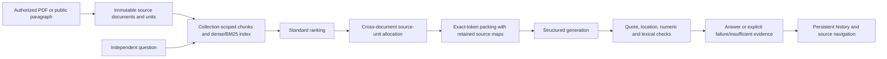

# Marginalia: knowledge base as a context layer

## Goal and boundaries

The contribution is a source-aware context layer that selects and assembles
evidence across documents before generation. It is not a new language model.
The same document, source-span, collection, packing and citation contracts serve
the public benchmark and the textbook application.

The assessment path is additive. Existing book chats keep Retrieval Baseline v1,
their frozen online/offline profiles and independent-message behavior. New
collection questions search a selected set of documents and retain their own
history. The open evaluation measures bounded HotpotQA distractor selection,
not full-Wikipedia search. [EVAL.md](EVAL.md) separates measured gains from
limitations. The authorized PDF demo has two source-reviewed answers, one of
them an explicit cached adapter replay; reliable local Qwen synthesis is not
established.

## Architecture and data flow

`textbook_audit` owns the shared evidence and evaluation implementation.
`textbook_chat` adapts it to FastAPI, SQLite, the local/online providers and the
React collection interface. Runtime question loading is separate from reference
answer loading. A corpus index can be shared, but every retrieval request has
an explicit document scope.

**Sources.** A PDF's original byte SHA-256 defines its document ID. Pages,
chapters and chunks are locations, not manufactured extra documents.
HotpotQA documents retain their exact article titles and original sentence
arrays. Immutable `SourceDocument` and `SourceUnit` records bind source/content
hashes, document identity, physical PDF page or sentence index, and original
text. Filenames are display information, not source identity.

**Provenance.** Text transformations carry maps of zero-based, half-open Python
code-point ranges. Cleaning, overlapping chunks, merging, clipping, index
reload and snapshot persistence retain these maps. Citation resolution checks
the document and unit together, and only permits characters retained in the
actual supplied evidence. These are text locations, not PDF bounding boxes.
Unverified printed-page labels are omitted; a PDF citation names its physical
page. This fixes the new path without rewriting historical v1 page claims.

**Collections and persistence.** Additive SQLite migrations preserve books,
chats and prior answers. Sources may belong to several collections; membership
has a fingerprint and updates use an expected prior fingerprint. Compiled
indexes bind source, corpus, embedding/profile and vector identities. A changed
source set cannot silently reuse an old index. Original PDF copies are owned
independently of library entries, so deleting a book does not erase collection
citations. Retained bound sources cannot be deleted through the library guard.

Collection questions are self-contained. Previous messages are displayed but
are never model history. One active question per collection is permitted;
terminal results are immutable. Restarted active work becomes an explicit
failure rather than silently restarting a potentially paid request.

## Retrieval and evidence assembly

All assessment arms use the pinned BGE-small-en-v1.5 snapshot, identical chunks,
the same ten candidate paragraphs per question, and the same evidence budget.
The standard references are normalized dense top-five ranking, BM25-only
ranking, and unweighted dense/BM25 reciprocal-rank fusion with k=60. The standard
dense/hybrid references do not inherit the proposed selector.

The proposed `budgeted-cross-document-selection-v1` component operates locally:

1. Order documents by their best hybrid-ranked chunk. Exact normalized article
   titles mentioned in the first two anchor chunks can add a title-link bonus.
2. Keep up to six documents. Within each, rank retained source-unit parts with
   BM25; linked documents also use their title in this local unit query.
3. Offer up to three units per document in round-robin order. This prevents one
   verbose, highly ranked source from consuming the entire context first.
4. Pack this stream with an exact 1,024 `o200k_base` token ceiling, including
   document/location headings. Clip at source characters rather than decoding
   an arbitrary token prefix, and validate the retained maps.

The six-document/three-unit/title-weight-0.2 choice came from a declared
development-only grid. If the maximum dense score is below 0.25 and there is
no positive lexical score, selection returns empty evidence. Document diversity
is a hypothesis supported by this small evaluation, not a guarantee that two
documents are always relevant.

The named ablation bypasses only this allocation component. It uses the exact
hybrid top-five evidence and the same packer/generator, so it is intentionally
equivalent to hybrid, not an artificially different fourth baseline. Final
execution reuses identical requests within that run, including terminal
responses whose claims fail validation. Reusing only valid responses would
independently resample the ablation and confound the comparison.

## Generation, checks and application surfaces

The frozen benchmark generator is `gpt-4o-2024-08-06`, temperature zero, 768
output tokens, no SDK retries. Every arm shares the prompt and JSON contract:
status, a short answer, factual claims with literal quotations and
evidence/unit pairs, and missing-information messages.

Answered output requires nonempty cited claims. A quote must be a contiguous
retained source substring that maps back to the cited original unit. Numeric
and lexical-support screens reject obvious unsupported statements; short-answer
tokens must be justified in the claims. Invalid JSON, altered quotations,
missing source pairs and unsupported numbers are explicit failures with raw
output retained. Insufficient evidence is a distinct, nonfactual response.

These checks **do not prove semantic entailment**. A valid address can support
the wrong relationship, omit an intermediate role, or fail to justify a yes/no
answer. Preselected source inspection is therefore reported separately, and
invalid outputs remain in all score denominators.

The Collections page provides source selection, independent questions, explicit
backend selection and quotation/page navigation. Public history projects only
answer and usage metadata in SQLite; it does not deserialize large raw
snapshots on every poll. New query snapshots contain only contributing chunks
(or one explicitly labeled diagnostic candidate for empty evidence). Raw
snapshots remain accessible through diagnostics.

PDF offline queries use a separate `collection-local-extractive-v1` adapter.
It offers query-ranked literal source clauses; the local model selects IDs and
a short synthesis, and the adapter constructs exact claims/citations. Deictic
clauses retain preceding context. Unknown/duplicate IDs are rejected, and
abstention or one-source answers remain possible. Both native selection and
adapted output are retained. This is not the benchmark generator and does not
establish unrestricted local paraphrasing quality. Book chats retain their
384-token/no-thinking default; collections explicitly allow 768 tokens.

Online PDF queries use `collection-online-extractive-v1`, selecting the same
source-clause IDs through a structured schema. Exact quotes/unit pairs are
constructed from those selections, not repaired after free-form generation.
For explicitly yes/no questions, answer adapter v2 extracts only an unambiguous
native Yes/No prefix. It does not infer a new polarity or repair numeric/entity
answers. A zero-call replay can create a separately labeled corrected projection
from saved native output while preserving the original failed row. Native
output, source options and adapter identity remain auditable.

## Reproduction, rights and tradeoffs

The Windows x64 CPython 3.12 CPU profile has a hash-locked dependency/build
closure, exact public model/data/tokenizer acquisition, and a locked frontend.
The final freeze binds configuration, protocol and 20 normalized-LF execution
files. The cached path rebuilds from complete raw outputs, reference labels
and source/context snapshots without inference, retrieval or an API key.
Historical newline compatibility is an explicit text-only v2 profile; binary
PDF/model/index identities remain exact bytes.

Paid dispatch reserves an attempt atomically in one persistent 500-attempt
ledger, with separate development/final/rerun/contingency caps. Failures and
abandoned reservations count. Online collection use requires transmission
acknowledgment and can consume only contingency, not the final reserves. Errors
retain safe types/status codes rather than credential-bearing exception text.
Unknown usage is unknown cost, not zero.

HotpotQA-derived artifacts retain CC BY-SA 4.0 attribution; the upstream
scorer is separately Apache-2.0. Textbook indexing/demo permission does not
grant redistribution or external transmission. Original/derived PDF material
stays in ignored local storage. The user authorized six excerpts-only online
demo calls; that permission is neither a standing approval nor redistribution
permission. Further online use still requires explicit acknowledgment.
Private submission access and preexisting textbook-derived assets still need
the separate handoff/rights review.

The measured tradeoff is more complete document coverage, lower document
precision, and extra selection time. Complete supporting-fact coverage did not
improve over dense; answer/joint gains over dense remain uncertain. Long PDF
pages, extraction artifacts and local model over-abstention expose limits that
sentence-level benchmark success does not solve.

Next work should improve relevant PDF fact retention and semantic completeness,
obtain independent human review, and evaluate a larger declared cohort or
growing corpus. OCR, arbitrary file types, new model bake-offs and distributed
serving are outside this submission's scope.
